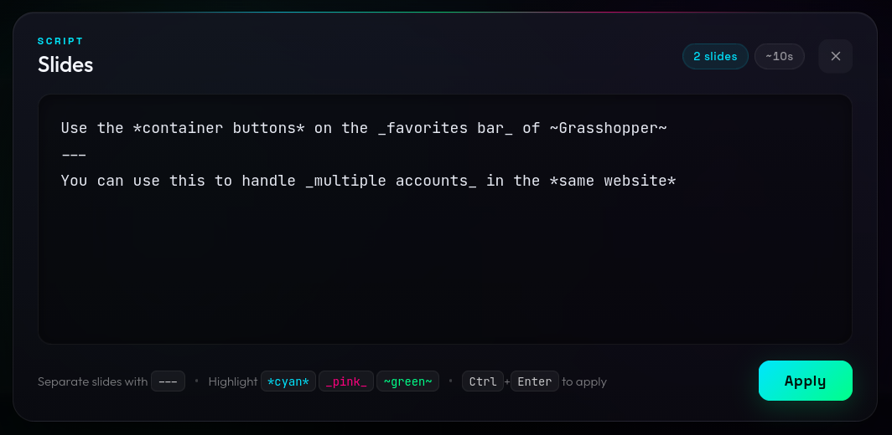
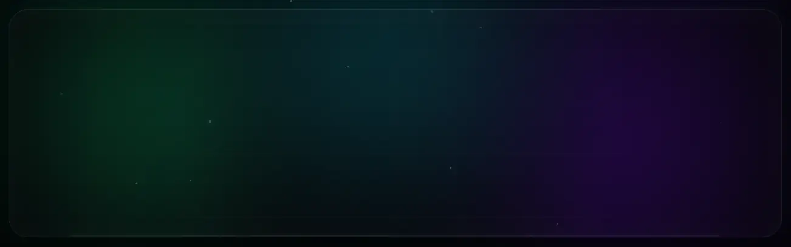

# OBText ✨

> **Cinematic, animated text slides designed for OBS Studio and product showcases.**

OBText turns plain text into smooth, cyber-aesthetic kinetic typography with 3D character reveals, neon highlights, ambient lighting, and particle effects. Built specifically for explainer videos, feature announcements, live streams, and video demos where text presentation needs to look premium without editing software keyframing.

---





---

## 🌟 Highlights

- **OBS-Optimized Clean Capture**: Minimalist, ghosted control dock that auto-hides entirely during playback alongside the mouse cursor.
- **Configurable Slides via `---`**: Easily separate slides with markdown-style horizontal rules (`---`). Multi-line slides are fully supported.
- **Smart Reading Duration**: Slide display durations automatically scale based on character and word counts with smooth acceleration for longer passages.
- **Inline Text Highlights**: Highlight key phrases with instant inline markup (`*cyan*`, `_pink_`, `~green~`).
- **Live Slide Editor**: Built-in glassmorphism dropdown editor with real-time slide count, total runtime estimation, and `localStorage` persistence.
- **Zero Build Tools**: Pure HTML, CSS, and vanilla JavaScript—runs straight from the filesystem or any static web server.

---

## 🚀 Quick Start

### 1. Open Locally
Simply open [`index.html`](file:///mnt/struct_1/code/obtext/index.html) in any modern web browser (Chrome, Firefox, Edge, Safari):

```bash
# Optional: serve locally with any static server
python3 -m http.server 8080
```

### 2. Add to OBS Studio
1. In OBS Studio, add a new **Browser Source**.
2. Point it to your local file path (or `http://localhost:8080/index.html`):
   - **URL / Path**: `file:///path/to/obtext/index.html`
   - **Width**: `1920` (or `1280` depending on your canvas)
   - **Height**: `1080` (or `720`)
   - **FPS**: `60`
3. Check **Shutdown source when not visible** (recommended).
4. Interact with the source by right-clicking it in OBS and selecting **Interact** to open the editor or start/stop playback.

---

## ✍️ Slide Syntax & Formatting

Open the slide editor by hovering over the top-right corner dock and clicking the **Script Editor** button (or press <kbd>E</kbd>).

### Slide Separation
Separate each slide using three or more dashes (`---`):

```text
Welcome to the product demo
---
Built for high-impact presentations
---
This slide has
two stacked lines!
```

### Inline Highlights
Add vibrant neon gradients and glows to words or phrases:

| Markup | Highlight Effect | CSS Class |
| :--- | :--- | :--- |
| `*text*` | Neon Cyan to Purple gradient glow | `highlight-cyan` |
| `_text_` | Hot Pink to Purple gradient glow | `highlight-pink` |
| `~text~` | Electric Green to Cyan gradient glow | `highlight-green` |

#### Highlight Example:

```text
Use the *container buttons* on the _favorites bar_ of ~Grasshopper~
---
Handle _multiple accounts_ in the *same browser session*
---
Deploy instantly with ~zero downtime~
```

> **Note**: Punctuation right outside highlights (e.g. `*Grasshopper*!`) stays attached cleanly, and snake_case variable names (`my_var_name`) won't trigger unwanted formatting.

---

## ⏱️ Smart Timing System

Instead of rigid fixed delays, OBText calculates display times adaptively:

$$\text{Duration} = \text{Reveal Stagger Time} + \text{Base Read (600ms)} + (\text{Word Count} \times \text{220ms}) + (\text{Extra Lines} \times \text{250ms})$$

- **Short titles** transition promptly without awkward pauses.
- **Longer descriptions** linger long enough for viewers to comfortably read.
- **Dynamic Reveal Stagger**: Character animation speeds dynamically cap on longer sentences (max ~1.5s in, ~0.7s out) to maintain video momentum.
- **Bounded**: Clamped between a minimum of `2.2s` and a maximum of `15.0s`.

*All timing parameters can be customized directly in [`base.js`](file:///mnt/struct_1/code/obtext/base.js) under the `TIMING` object.*

---

## 🎮 Controls & Shortcuts

The subtle control dock lives in the **top-right corner**:

| Action | Dock Icon | Shortcut | Description |
| :--- | :---: | :---: | :--- |
| **Edit Slides** | 📝 | <kbd>E</kbd> | Opens the dropdown slide editor |
| **Start / Stop** | ▶ / ⏹ | <kbd>Space</kbd> | Starts or halts the presentation |
| **Restart** | 🔄 | <kbd>R</kbd> | Restarts presentation from slide 1 |
| **Apply Changes** | — | <kbd>Ctrl</kbd> + <kbd>Enter</kbd> | Applies textarea script without auto-starting |
| **Close Editor** | ✕ | <kbd>Esc</kbd> | Closes the slide editor |

### Ghost Dock & Mouse Auto-Hide
- **Idle**: The dock sits at a faint, non-intrusive 14% opacity.
- **Running**: The dock and mouse cursor fade to **0% opacity** so OBS recordings capture only the animated card.
- **Waking Dock**: Moving the mouse during playback momentarily reveals the dock at low opacity so you can pause or restart on demand.

---

## 🎨 Visual Architecture & Styling

- **Stage Card**: Glassmorphism container with backdrop blur, deep shadow, and alternating phase accent colors per slide (cyan / pink themes).
- **Typography**: Paired with modern Google Fonts:
  - Display: **[Outfit](https://fonts.google.com/specimen/Outfit)** (heavy weight 800)
  - Accents & Status: **[Space Grotesk](https://fonts.google.com/specimen/Space+Grotesk)**
  - Script Editor: **[JetBrains Mono](https://fonts.google.com/specimen/JetBrains+Mono)**
- **Atmosphere**:
  - 3 floating radial gradient orbs
  - Perspective-tilted infinite moving cyber grid
  - Floating ambient particles
  - Vintage scanlines and edge vignette

---

## 🛠️ Project Structure

```text
obtext/
├── index.html      # Stage, overlays, dock navigation & modal editor markup
├── style.css      # Cyberpunk visual system, animations, and responsive styles
├── base.js        # Script parser, timing engine, animation runner & state management
└── README.md      # Documentation
```

---

## 📄 License

MIT License. Feel free to use, modify, and integrate this into your video workflows, streams, and product recordings.
